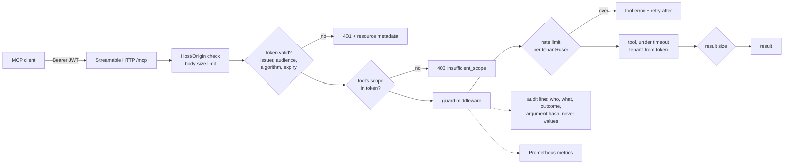

# mcp-server-toolkit

[](https://github.com/darshansatpathy/mcp-server-toolkit/actions/workflows/ci.yml)
[](https://github.com/darshansatpathy/mcp-server-toolkit/actions/workflows/codeql.yml)


A production template for [Model Context Protocol](https://modelcontextprotocol.io) servers in Python. The SDK makes a tool a decorated function; this repository adds what it takes to put one in front of real users: **OAuth resource-server auth, per-tool scopes, tenant isolation, rate limits, timeouts, size limits, an audit log, metrics, a checked tool contract, a container and Kubernetes manifests**, all tested end to end.

The example domain is a support-ticket system (search, read, create, comment, close). Replace the tools; keep the shape.

## What a request goes through



| Concern | How | Where |
|---|---|---|
| Authentication | The server is an OAuth 2.1 **resource server** for your IdP. JWTs verified against its JWKS with pinned issuer, audience (RFC 8707) and asymmetric algorithms; `alg: none` and HMAC-with-the-public-key are refused. Protected-resource metadata (RFC 9728) tells clients where to sign in. | `auth.py` |
| Authorization | Each tool declares its scopes. Callers only see tools they may use; a call without the scope gets HTTP **403 `insufficient_scope`** so the client can step up, and the guard enforces the same rule on every transport. | `policy.py`, `server.py` |
| Tenancy | The tenant comes from a token claim, never an argument. Every query is scoped by it; another tenant's ticket is indistinguishable from a missing one. | `store.py` |
| Abuse and cost | Token buckets per tenant and user, separate for reads and writes, in memory or shared across replicas in Redis. Tool timeouts, result-size and request-size limits, cursor pagination. | `ratelimit.py`, `policy.py` |
| Safe retries | `create_ticket` takes an idempotency key; closing twice with the same resolution is a no-op. Annotations say which tools are read-only, destructive or idempotent. | `tools.py` |
| Prompt injection | Tool descriptions and the prompt mark ticket text as user-written data. Full-text search quotes every word, so input is never query syntax. | `tools.py`, `store.py` |
| Observability | One JSON audit line per call (argument names and a hash, never values), Prometheus metrics by tool and outcome, `/healthz`, `/readyz`. | `logs.py`, `metrics.py` |
| API stability | `schemas/contract.json` holds every tool's schemas, scopes and annotations; CI fails if the server drifts from it. | `cli.py` |
| Deployment | Non-root image that runs with a read-only root filesystem; Compose stack with two replicas sharing Redis; Kustomize manifests with HPA, PDB, zone spread, restricted Pod Security and a NetworkPolicy. | `Dockerfile`, `deploy/` |

## Quick start

```bash
python -m venv .venv && . .venv/bin/activate
pip install -e ".[dev]"

mcpkit dev-keys                   # a local signing key and JWKS in dev/ (never for production)
mcpkit serve                      # http://127.0.0.1:8000/mcp
TOKEN=$(mcpkit dev-token --scopes "tickets:read tickets:write")
```

Connect any MCP client to `http://127.0.0.1:8000/mcp` with `Authorization: Bearer $TOKEN`. From Python:

```python
import httpx2
from mcp import Client
from mcp.client.streamable_http import streamable_http_client

async with httpx2.AsyncClient(headers={"Authorization": f"Bearer {token}"}) as http:
    async with Client(streamable_http_client("http://127.0.0.1:8000/mcp", http_client=http)) as c:
        created = await c.call_tool("create_ticket", {"title": "Sync stuck", "body": "...", "idempotency_key": "retry-001"})
```

For a desktop client over stdio, `mcpkit serve --transport stdio` runs as a local principal whose tenant and scopes come from `MCPKIT_STDIO_TENANT` and `MCPKIT_STDIO_SCOPES`.

## Production

Point it at your IdP and run several replicas:

```bash
MCPKIT_ISSUER=https://idp.example.com
MCPKIT_AUDIENCE=https://mcp.example.com/mcp            # the URL clients use; tokens must carry it as aud
MCPKIT_JWKS_URL=https://idp.example.com/.well-known/jwks.json
MCPKIT_REDIS_URL=redis://redis:6379/0                   # one rate-limit bucket per principal across replicas
MCPKIT_ALLOWED_HOSTS='["mcp.example.com"]'
```

`docker compose up` runs two replicas and Redis locally. `deploy/k8s` is a Kustomize base. All settings are in [`config.py`](src/mcpkit/config.py).

## Performance

32 clients over Streamable HTTP, each call with an RS256 token verified on arrival, against one uvicorn worker and SQLite: **3,200 tool calls at 225 a second, 0 errors**, p95 200 ms, with clients and server sharing one busy two-core machine. A principal bursting 200 reads gets 121 through and 79 refused with a retry-after. Details in [`docs/performance.md`](docs/performance.md); `make bench` reproduces it.

## Tests

`make check` runs ruff, mypy (strict), the contract check and 40+ tests with coverage above 85%, including:

- tokens with a wrong audience, issuer, key, algorithm, or expiry; the HMAC key-confusion attack;
- tools hidden and refused without scope; 403 `insufficient_scope` over HTTP with the right `WWW-Authenticate`;
- tenant isolation in-process and over HTTP; idempotent create and close; input validation; search input that looks like FTS syntax;
- rate limits per principal and for writes; a shared bucket across two Redis-backed replicas; timeouts; result and body size limits; DNS-rebinding protection;
- the audit line carrying no argument values; metrics; the stdio transport as a subprocess.

## Design decisions

[ADR 1](docs/adr/0001-resource-server-auth.md) resource-server auth · [ADR 2](docs/adr/0002-scopes-per-tool.md) scopes per tool · [ADR 3](docs/adr/0003-limits-and-audit.md) limits and audit · [ADR 4](docs/adr/0004-contract-as-a-file.md) the contract as a file

## License

MIT
